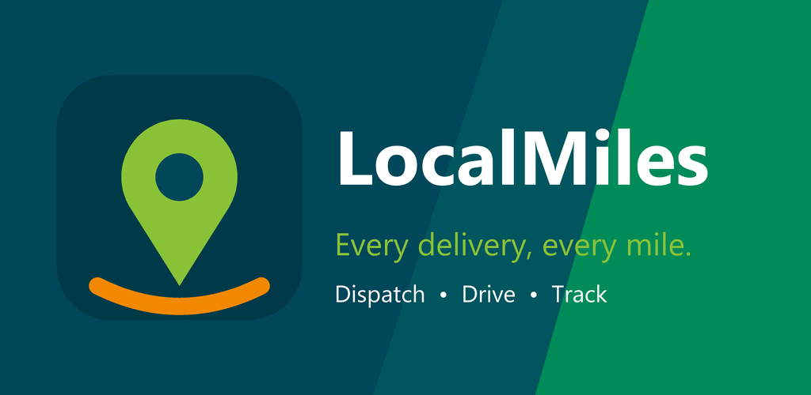
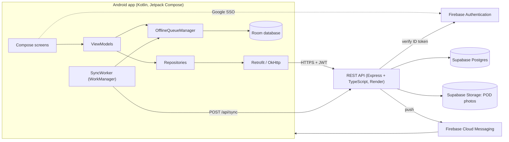

<p align="center">
  
</p>

# LocalMiles — Technical Report

**PROG7314 (Programming 3D) | Portfolio of Evidence — Final POE | Version 2.0.0**

[](https://github.com/EMKNDN/emkndn-prog7314-2026-prog7314-poe-st10452806-anjormisser/actions/workflows/android-ci.yml)

| | Link |
|---|---|
| **Final POE demonstration video** | _add the unlisted YouTube link here_ |
| Part 2 prototype video | https://youtu.be/W0VLYsKjTDo |
| Release notes | [RELEASE_NOTES.md](RELEASE_NOTES.md) |
| Release / Play Store process | [docs/RELEASE.md](docs/RELEASE.md) |
| Play Store listing text | [docs/play-store/listing.md](docs/play-store/listing.md) |

**Group members**

| Name | Student number |
|---|---|
| Anjor Misser | ST10452806 |
| Kiara Naidoo | ST10252256 |
| Sayali Sookdeo | ST10458649 |
| Iqra Nazir | ST10448362 |

## Contents

1. [Purpose and scope](#1-purpose-and-scope)
2. [Features](#2-features)
3. [Architecture and design decisions](#3-architecture-and-design-decisions)
4. [Technology stack](#4-technology-stack)
5. [Key feature implementations](#5-key-feature-implementations)
6. [REST API](#6-rest-api)
7. [Testing](#7-testing)
8. [Version control and GitHub Actions](#8-version-control-and-github-actions)
9. [Release and Play Store readiness](#9-release-and-play-store-readiness)
10. [Running the project](#10-running-the-project)
11. [Team contributions](#11-team-contributions)

---

## 1. Purpose and scope

Small and medium courier operators in South Africa still coordinate deliveries with phone calls, WhatsApp groups and paper waybills. That leads to missed delivery windows, disputed proof of delivery, no live visibility for clients, and lost work when a driver is out of network coverage.

**LocalMiles** is one Android app with three role-based views that share a single login and a single backend:

| Role | What they do |
|---|---|
| **Dispatcher** (admin) | Creates jobs and stops, manages vehicles and drivers, promotes users, watches drivers on a live map and reviews delivery history. |
| **Driver** | Works through assigned jobs stop by stop, captures proof of delivery (photo, signature, GPS) and keeps working when there is no signal. |
| **Client** | Tracks their own shipments stop by stop. |

The API does the heavy lifting: it verifies sign-in, enforces status rules and the GPS proximity rule, stores data, sends push notifications and applies offline actions.

## 2. Features

### Required features

| Requirement | How it is met |
|---|---|
| Single sign-on | Google Sign-In (Credential Manager) → Firebase ID token → verified by the API → session JWT. |
| Biometric authentication | Fingerprint/face prompt on app launch and an **Unlock with biometrics** button on the login screen (AndroidX Biometric). |
| Settings | Per-role settings: theme (light / dark / system), language, biometric login, navigation app, screen-on and notification preferences. |
| REST API + database | Express + TypeScript API on Render with a Supabase Postgres database. |
| Offline mode with sync | Room queue + WorkManager auto-sync, with a Pending / Synced / Failed banner in the UI. |
| Real-time notifications | Firebase Cloud Messaging pushes sent by the API on job, stop and sync events. |
| Multi-language | English, Afrikaans and isiZulu. |

### User-defined features

| # | Feature | Value |
|---|---|---|
| 1 | Fleet management | Dispatcher adds, edits and activates/deactivates vehicles. |
| 2 | Driver promotion workflow | Promote a client user to a driver in one step (creates the driver record and changes the role). |
| 3 | Sequenced delivery stops | Stops must be done in order, with a live "Stop X of N" counter. |
| 4 | Client shipment tracking | Clients see live status and stop-by-stop progress. |
| 5 | Delivery history and live map | Dispatcher reviews finished jobs and sees driver positions on an OpenStreetMap live map. |
| 6 | Live driver location sharing | Drivers share their position while a job is en route. |
| 7 | Proof of delivery with GPS check | Photo + signature + the phone's real location; rejected if more than 200 m from the stop. |

### Screenshots

<!--
  Sayali: add the screenshots to docs/screenshots/ using the file names in docs/SHOT_LIST.md,
  then remove the comment markers around the tables below so they show up.

| Login | Biometric unlock | Settings |
|---|---|---|
|  |  |  |

| Driver stops | Offline banner | POD capture |
|---|---|---|
|  |  |  |

| Dispatcher live map | Fleet | Client tracking |
|---|---|---|
|  |  |  |
-->

## 3. Architecture and design decisions



**Why it is built this way**

- **MVVM with repositories.** Screens only show state from a ViewModel; repositories wrap the API; no screen talks to Retrofit directly.
- **The API is the source of truth.** Status transitions, the GPS proximity rule and role access are enforced on the server, so the app cannot bypass them.
- **One theme.** All colours come from `MaterialTheme.colorScheme` (see `Core/theme`), so every screen and both light and dark mode use the same palette: dark teal `#004759`, green `#018B58`, lime `#8AC237`, orange `#F28800`.
- **Offline first for drivers.** Drivers' actions are written to Room first when there is no connection and the server applies them later in order.

## 4. Technology stack

| Area | Technology |
|---|---|
| App | Kotlin, Jetpack Compose, Material 3, Navigation Compose, minSdk 34 |
| Networking | Retrofit 2, OkHttp, Gson |
| Local storage and background work | Room, WorkManager |
| Authentication | Firebase Authentication, Credential Manager, AndroidX Biometric |
| Notifications | Firebase Cloud Messaging |
| Maps and location | OpenStreetMap (osmdroid), Google Play Services Location |
| API | Node.js, Express 5, TypeScript |
| Database and storage | Supabase (Postgres + Storage bucket `pod-uploads`) |
| Hosting | Render |
| Testing / CI | JUnit, MockK, kotlinx-coroutines-test, GitHub Actions |

## 5. Key feature implementations

### Single sign-on and biometrics
The app gets a Google credential, exchanges it for a Firebase ID token and sends it to `POST /api/auth/login`. The API verifies it and returns a session JWT and the user's role. When biometric login is on, a signed-out user keeps their saved session on the phone so the login screen can offer **Unlock with biometrics**; with it off, signing out wipes the session.

### Offline mode and sync
1. When a driver action fails because there is no network (job status, stop status or proof of delivery), `DriverViewModel` saves it to Room through `OfflineQueueManager` as **Pending**.
2. The screen updates straight away (optimistic update) and a banner shows *"N change(s) saved offline, waiting to sync"*.
3. `SyncWorker` is scheduled with a "network connected" constraint, so WorkManager runs it as soon as the connection returns.
4. The worker sends the pending actions to `POST /api/sync` oldest first, 50 at a time. Each result marks the action **Synced** or **Failed**. Network errors are retried with exponential backoff.
5. Failed actions show **Retry** and **Dismiss**. Retry re-queues them under a new id.
6. Actions are tagged with the user who made them, so a different account never sends them. Lists are loaded from the server and then overlaid with unsynced changes so they never flip back.

### Proof of delivery
The driver enters the recipient, takes a photo and signs on screen. The phone reads its real GPS position; the app checks the 200 m limit locally (so it works offline) and the API checks it again. Photos are shrunk before upload; offline, they travel inside the sync request as base64.

### Notifications
Devices register their FCM token with `POST /api/devices/token`. The API sends pushes through Firebase Cloud Messaging (job assignment, status changes, failed deliveries, sync issues) and also stores them for the in-app list.

### Languages
`values/` (English), `values-af/` (Afrikaans) and `values-zu/` (isiZulu). The language is chosen in Settings and applied app-wide.

## 6. REST API

Base URL: `https://localmiles-api.onrender.com/api/` · Every route except login needs `Authorization: Bearer <jwt>`.

| Area | Routes |
|---|---|
| Auth and users | `POST /auth/login`, `PATCH /auth/switch-role`, `GET /users`, `PATCH /users/me`, `PATCH /users/:id/role` |
| Clients, depots | `GET/POST /clients`, `GET/POST/PATCH/DELETE /depots` |
| Drivers and vehicles | `GET/POST/PATCH/DELETE /drivers`, `POST /drivers/me/location`, `GET/POST/PATCH/DELETE /vehicles` |
| Jobs | `GET/POST /jobs`, `PATCH /jobs/:id`, `PATCH /jobs/:id/status`, `GET /jobs/:id/route`, `GET /jobs/:id/driver-location` |
| Stops | `GET/POST /jobs/:jobId/stops`, `PATCH /stops/:id`, `PATCH /stops/:id/status` |
| Proof of delivery | `POST/GET /stops/:stopId/pod`, `GET /jobs/:jobId/pods` |
| Notifications and devices | `GET/POST /notifications`, `POST /devices/token` |
| Offline sync | `POST /sync`, `GET /sync`, `GET /sync/:id`, `POST /sync/:id/retry` |

The API lives on the `Backend-API` branch (folder `localmiles-api/`).

## 7. Testing

| Where | What |
|---|---|
| `app/src/test` (JVM) | Offline queue (`OfflineQueueManagerTest`), pending-change overlay (`OfflineOverlayTest`), distance rule (`PodLocationTest`), biometric and language preferences, dispatcher view models, API error messages, history filter, live map model and form validation. |
| `app/src/androidTest` | `OfflineActionDaoTest` runs the Room queries on a real in-memory database (needs a phone or emulator). |
| `localmiles-api/test` | API status rules, auth middleware and sync handling (`npm test`). |

Run the app unit tests with `./gradlew testDebugUnitTest`.

## 8. Version control and GitHub Actions

- All work is committed to this GitHub repository (no zip uploads) by all four team members, on feature branches merged into `LocalMiles-App`.
- The final submission commit must be tagged **`Final-POE`** (steps in [docs/RELEASE.md](docs/RELEASE.md)).
- **Android CI** ([`.github/workflows/android-ci.yml`](.github/workflows/android-ci.yml)) runs on **every push to any branch**, on tags and on pull requests:
  1. Runs the unit tests (`testDebugUnitTest`)
  2. Builds the debug APK
  3. Builds the release APK (signed when the signing secrets exist, otherwise unsigned)
  4. Uploads the test report and the APKs as artifacts
  5. A second job checks out the `Backend-API` branch, type-checks it and runs the API tests

## 9. Release and Play Store readiness

- **Version 2.0.0** (`versionCode 2`).
- **Custom icon**: adaptive icon (lime pin over an orange road on dark teal) with a monochrome layer for themed icons. The Play Store icon and feature graphic are in [`docs/branding`](docs/branding).
- **Signed release build** with a private upload key that is never committed (`keystore.properties` is git-ignored). The release app talks to the hosted API over HTTPS.
- Store text, data-safety answers and a privacy policy draft are in [`docs/play-store`](docs/play-store). The signing steps are in [`docs/RELEASE.md`](docs/RELEASE.md).

## 10. Running the project

1. Open the project in Android Studio and let Gradle sync.
2. Add to `local.properties` (git-ignored):
   ```properties
   GOOGLE_WEB_CLIENT_ID=<web client id from the Firebase console>
   API_BASE_URL=http://<your PC's LAN IP>:3000/api/
   ```
3. Run the API (`Backend-API` branch): `npm install`, copy `.env`, `npm run dev`.
4. Run the `app` configuration on a **physical phone** on the same Wi-Fi as the PC.

Debug builds use the shared `app/debug.keystore`, so the Firebase SHA-1 is the same on every machine.

## 11. Team contributions

| Member | Area |
|---|---|
| Anjor Misser | REST API, SSO, dispatcher and driver workflows, push notifications, location tracking, offline sync integration, release signing |
| Kiara Naidoo | Biometric authentication, multi-language support |
| Iqra Nazir | Room database for the offline queue |
| Sayali Sookdeo | UI consistency, release preparation, documentation |

## Part 3 – Final Application Development

### Biometric Authentication
For the final development of LocalMiles, we added biometric authentication to improve the security of the application. This allows users to unlock the app using their fingerprint or facial recognition after completing Google Sign-In. We also included an option in Settings that allows users to enable or disable biometric authentication according to their preference.

### Offline Mode and Synchronisation
We improved LocalMiles to support drivers who work in areas where internet connectivity is unreliable. Room Database is used to store actions locally, such as delivery status updates and Proof of Delivery submissions. These actions are added to an offline queue and synchronised with the backend using WorkManager once an internet connection becomes available. We also included synchronisation indicators so users can identify which actions are still pending and which have been successfully synchronised.

### Push Notifications
We integrated Firebase Cloud Messaging to allow LocalMiles to send and receive push notifications. This helps keep users informed about important delivery activities, including job assignments and delivery status updates. The application registers its Firebase notification token with the backend so notifications can be directed to the correct device.

### NoSQL Database
We integrated Firebase Firestore alongside our existing Supabase PostgreSQL database. Firestore provides NoSQL data storage for the selected application functionality, allowing data to be stored and retrieved using a document-based structure. Supabase PostgreSQL continues to manage the application's existing relational data.

### Blob Storage
We incorporated cloud blob storage to manage Proof of Delivery photographs. Instead of storing image files directly in the main database, the application uploads them to cloud storage and keeps the associated image reference for later retrieval. This helps separate file storage from the application's main database records.

### Multi-language Support
We extended the Settings functionality to support multiple South African languages. Users can select their preferred language through the language picker. This improves accessibility by allowing users to interact with the application in a language they are more comfortable using.

### Automated Build and Testing
We configured GitHub Actions to automate the Android build and testing process. Whenever changes are pushed to the remote GitHub repository, the workflow runs automatically to check whether the application builds successfully and whether the configured unit tests pass. This helps us identify issues earlier during development.

### Application Release and Final UI
We improved the overall appearance of LocalMiles by working on the application icon, visual assets, colours, fonts and input validation. We also prepared the signed release APK and Play Store screenshots and listing as part of the final release preparation. Testing on a physical Android device was included to check the application's functionality outside the emulator.

Full change history: [RELEASE_NOTES.md](RELEASE_NOTES.md).
